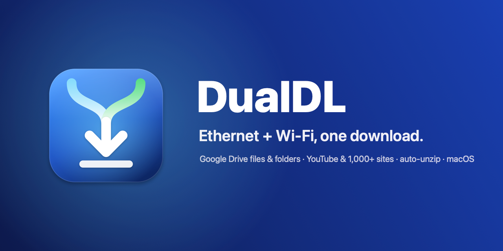
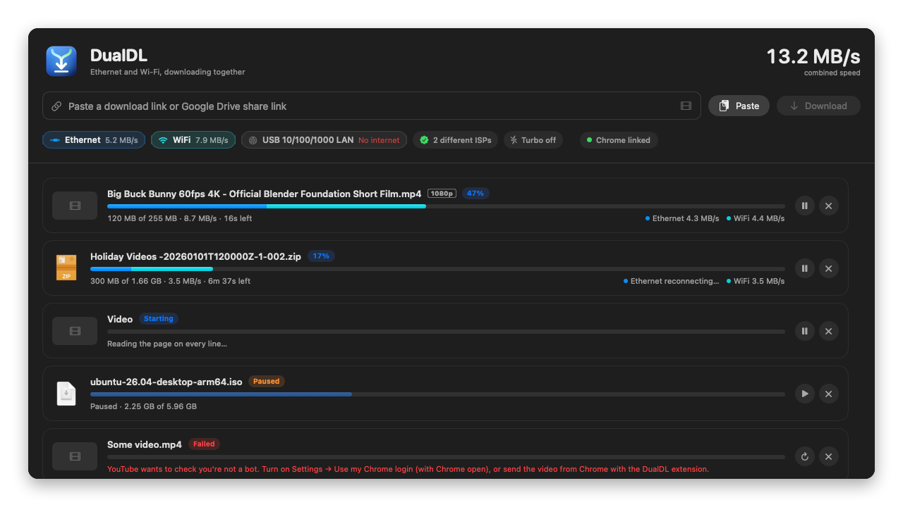
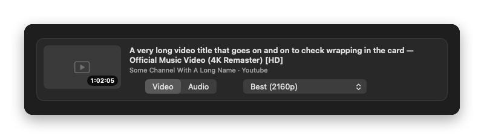
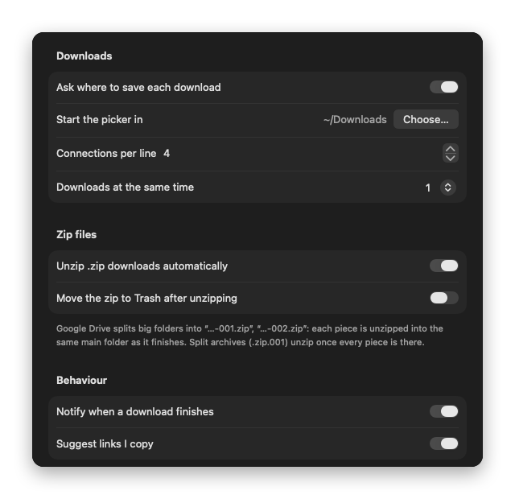
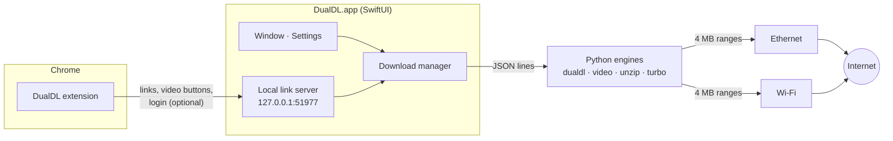

<p align="center">
  
</p>

<p align="center">
  <b>A native macOS download manager that uses your Ethernet <i>and</i> Wi-Fi at the same time.</b><br>
  Two internet connections from two providers? DualDL splits every download across both and adds their speeds together.
</p>

<p align="center">
  <a href="https://dualdl.netlify.app"><b>dualdl.netlify.app</b></a> · <a href="https://github.com/iamtanzib/DualDL/releases/latest/download/DualDL.zip"><b>Download for Mac</b></a>
</p>

<p align="center">
  
  
  
  
  
</p>

<p align="center">
  
</p>

---

## Why

macOS sends everything through **one** network connection at a time. If you have a cable from one ISP and Wi-Fi from another, the second one just sits there. DualDL cuts each file into 4 MB pieces and pulls them over **every line at once**. A 476 MB Google Drive file that takes ~2 minutes on one line comes down in about 65 seconds on two.

## Features

| | |
|---|---|
| ⚡ **Two lines, one download** | Every file is fetched in parallel ranges over Ethernet *and* Wi-Fi. The faster line automatically takes more of the work. |
| 🧭 **Knows your lines** | Shows each line's ISP and public IP, warns if both lines are really the same connection, skips lines that are offline, and rechecks whenever the network changes. |
| 📁 **Google Drive, properly** | File links, big files with the virus-scan prompt, and **whole folder links** (every file, with subfolders). Re-adding a folder skips what's already there. |
| 🗜️ **Auto-unzip** | Drive's "Download all" pieces (`…-001.zip`, `…-002.zip`) are unzipped into **one** folder as they finish; split archives (`.zip.001`) unzip once every piece is there. |
| 🎬 **Video & audio** | YouTube and 1,000+ sites via [yt-dlp](https://github.com/yt-dlp/yt-dlp): best quality, MP3 with cover art, and files that **open in QuickTime and Premiere** (VP9/AV1 are converted on the Mac's hardware encoder). |
| 🛟 **Finishes the job** | Expired links are refreshed mid-download (and a site's new link carries on where the old one stopped), busy servers are waited out, and failed downloads retry on their own (1 → 3 → 10 → 30 → 60 min). Pause, quit, even crash: it resumes where it stopped. |
| 🧩 **Chrome extension** | Catches Chrome's downloads (like FDM), adds *Download with DualDL* to right-click, puts *Best video / 1080p / MP3* buttons on video pages, and can lend the app your login for sites that need it. |
| 🚀 **Turbo browsing** *(optional)* | A local proxy that spreads Chrome's sites over both lines and fails over if one ISP drops. |
| 🪶 **Light on your Mac** | Downloads run at low priority, video conversion uses the media engine, and the app idles at a few % CPU. |
| 🔒 **Local & private** | No accounts, no servers, no telemetry. See [Privacy & security](docs/privacy-and-security.md). |

<p align="center">
  
</p>

## Requirements

- A Mac with **Apple Silicon** running **macOS 14 Sonoma or later**
- **Xcode Command Line Tools** (Swift compiler + Python 3): `xcode-select --install`
- *Optional:* **ffmpeg** for video joining, MP3 and Premiere-ready conversion ([martin-riedl.de](https://ffmpeg.martin-riedl.de) builds or `brew install ffmpeg`)
- *Optional:* **Google Chrome** for the extension
- To actually go faster: **two internet connections from different providers** (for example Ethernet from one ISP, Wi-Fi from another, or a phone hotspot)

## Install

### Download (easiest)

1. Download **[DualDL.zip](https://github.com/iamtanzib/DualDL/releases/latest/download/DualDL.zip)** and drag **DualDL.app** into Applications.
2. Open it. macOS says it can't check the app (it isn't notarized by Apple): open **System Settings → Privacy & Security** and click **Open Anyway**. Or in Terminal: `xattr -dr com.apple.quarantine /Applications/DualDL.app`
3. If macOS offers to install the **Command Line Tools**, say yes: DualDL's engine runs on the Python 3 that comes with them.

### Build it yourself

```bash
git clone https://github.com/iamtanzib/DualDL.git
cd DualDL
./build.sh
```

`build.sh` draws the icon, compiles the app, installs **DualDL.app** into `/Applications` (or `~/Applications`) and copies the Chrome extension to `~/Documents/DualDL Chrome Extension`. Because you built it yourself, macOS opens it without Gatekeeper warnings.

On first launch DualDL asks for:
- **Location**: only so macOS shares your Wi-Fi network's *name*. Your location is never read.
- **Notifications**: to tell you when a download is done.

### Chrome extension

1. Open `chrome://extensions` and switch on **Developer mode**.
2. Click **Load unpacked** and pick `~/Documents/DualDL Chrome Extension`.
3. After updating DualDL, press the extension's **reload ↻** button.

### Video tools

Open **Settings → Video → Install**. DualDL downloads [yt-dlp](https://github.com/yt-dlp/yt-dlp) and [Deno](https://github.com/denoland/deno) (Deno lets yt-dlp unlock YouTube's high-quality formats) from their official GitHub releases, checks their SHA-256 and keeps yt-dlp updated weekly.

## Using it

- **Paste a link** (or drop it on the window) and press **Download**. Several links at once work too.
- **Google Drive folder:** paste the folder link; you pick a destination once and every file follows, in the folder's own structure.
- **Video page:** a card shows the title, thumbnail and qualities. Choose *Video* (best, 2160p…480p, or *Plays everywhere (H.264)*) or *Audio* (MP3 or original).
- **From Chrome:** just click a download link, or right-click → *Download with DualDL*.
- **Already have a VP9 video that won't open?** Right-click it in the list → *Convert for Mac & Premiere*, or **File → Convert Video for Mac & Premiere… (⇧⌘K)**. The original goes to the Trash, not into oblivion.
- **Pause / resume everything** with the toolbar button; each row has its own controls and a right-click menu.

<p align="center">
  
</p>

## How it works



- **The app** (Swift) owns the list, the UI and settings, and starts one engine process per job.
- **The engines** (Python, no dependencies) do the network work: each socket is pinned to one interface with `IP_BOUND_IF`, so a line is used even when it isn't the Mac's default route.
- **yt-dlp** only reads video pages; the bytes come through DualDL's engine, and each line asks for its own stream link because sites tie links to the IP that asked.

Details: [Architecture](docs/architecture.md).

## Make it yours

Everything is plain source you can change: connections per line, chunk size, retry timings, which domains Turbo keeps together, video presets, colors, the icon, ports and the bundle id. The [customizing guide](docs/customizing.md) points to the exact place for each.

The engines also work on their own from Terminal; see the [command-line guide](docs/command-line.md):

```bash
python3 engine/dualdl.py "https://drive.google.com/file/d/FILE_ID/view"
python3 engine/dualdl.py --check-lines          # which ISP is each line on?
python3 engine/video.py --mode audio "https://www.youtube.com/watch?v=VIDEO_ID"
```

## Tests

```bash
tests/run.sh             # ~3 minutes, no internet needed
tests/run.sh --network   # adds real Google Drive and YouTube downloads
```

Over 150 checks: unzip edge cases, video conversion, Turbo routing, the Chrome extension (run under Deno with a fake Chrome), and end-to-end runs of the app's own download manager against a local server that misbehaves on purpose (expiring links, throttling, dead servers). It never touches your installed app's list or settings, and it renders every screen into `build/snapshots/` for a quick look.

## Good to know

- **Same ISP on both lines?** Then there's nothing to add up: one connection is the limit. DualDL tells you ("Same connection") and uses only one.
- **Turbo browsing** doesn't make a single video or page faster (one site stays on one line so logins keep working). It helps when many things load at once, and keeps browsing alive if one ISP drops.
- **YouTube says "confirm you're not a bot"?** Turn on **Settings → Chrome → Use my Chrome login**, or send the video from Chrome.
- More in [Troubleshooting](docs/troubleshooting.md).

## Responsible use

DualDL is a general-purpose download tool. Only download what you have the right to download, and respect each site's terms of service and copyright. DualDL isn't affiliated with Google, YouTube or any site it works with.

## Contributing

Issues and pull requests are welcome; see [CONTRIBUTING.md](CONTRIBUTING.md).

## License

[MIT](LICENSE) © 2026 Tanzib Sajib
